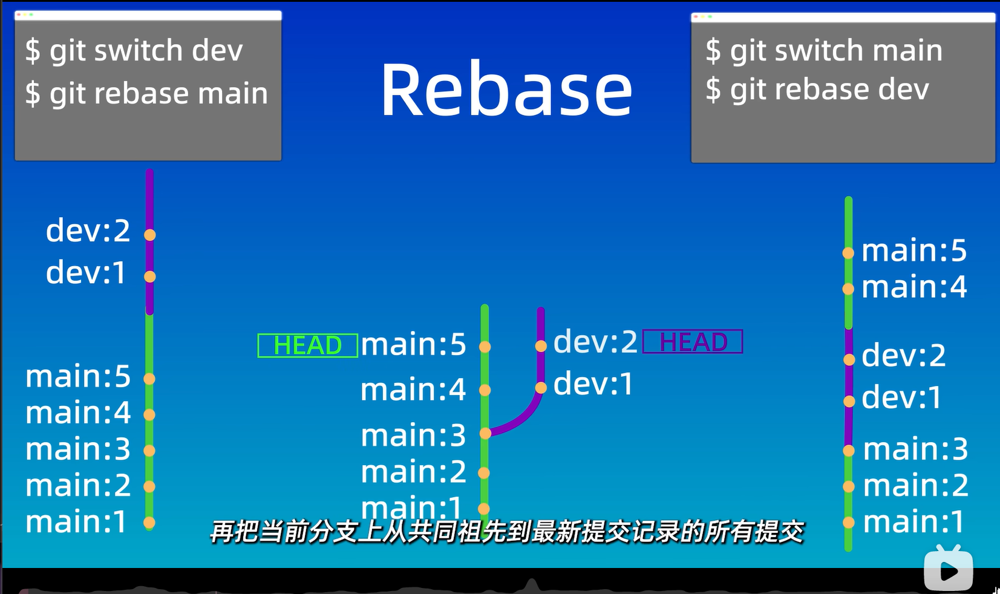

# Basic Git Commands
## 一、root
alias git-log="..."定义快捷片段
>git-log : git log --pretty=oneline --all --graph --abbrev-commit

>git status
```
git add .
git add filename
git add *.txt只提交txt形式下的文件
```
>git commit -m'注释'只会提交暂存区的文件
## 二、advance
### 1.reset
|命令	|工作区|	暂存区|
|:---:|:----:|:---:|
|git reset --soft	|	true	|	t|
|git reset --hard	|	false	|	false|
|git reset --mixed	|  true	|false   |

**这些命令后面接回退目标的版本号**
==soft(mixed命令再add一次成为第一个soft)==

==如何找回？==
`hard(git reflog看操作的历史记录，找版本号，下面的id，git reset --hard commitID版本找回)`
```
$ git reflog
0bcf3c6 (HEAD -> master) HEAD@{0}: reset: moving to 0bcf3c6
6094239 HEAD@{1}: commit: second
0bcf3c6 (HEAD -> master) HEAD@{2}: commit (initial): first com
$ git reset --hard commitID
```


### 2.diff
git diff查看修改的文件（==工作区和暂存区==）
git diff HEAD（==工作区和版本库==）
git diff --cached(==暂存区和版本库==)

(==以下是版本库与版本库之间的比较==)
git diff id id
git diff id HEAD（最新版本）
git diff HEAD~ HEAD（和上一版本比较）（波浪线后面还可以加上数字表示上几个版本）（最后可以再加上具体文件名针对）
>ep:git diff HEAD~2 HEAD file3.txt

vi file.txt修改文件，i键修改模式，改完esc+:wq退出


### 3.分支
git branch :ls every branch
git branch 加分支名: 创建分支
git branch -d删除分支
git branch -D
git checkout将路径转换到该分支(git switch加分支名亦可)
==git checkout -b 加分支名可以直接创建分支并将路径转换到该分支==
### 4.合并
git merge 加分支名dev1  合并分支   esc : wqj
（merge之前要先切换到目标合并分支）
之后有冲突就手动在记事本改成需要的，再add . commit	
                               
master分支
develop分支
feature分支
hotfix分支改bug
***

***
### 5.ignore
**仅作用于工作区**
==创建文件.gitignore 里面加*.a，表示该文件忽略==
**1.**`vi .gitignore+i+*.log+esc+:wq`==同类型文件==
**2.**`echo access.log > .gitignore`==单个文件==
`echo access.log >> .gitignore`==追加单个文件在.gitignore内容的后面==
**3**.`vi .gitignore+i+temp/+esc+:wq`==temp文件夹下文件==

**以上两种不同编辑方法可互换使用**

else:

.gitignore
```
*.a
!lib.a
#忽略所有.a文件，除了lib.a
#用作注释
```
***

### 6.概论
cd ..        向上一级
cd 文件名    向下一级
pwd

#### 1.rm
只删文件，还要add，因为==只删了工作区==
git rm file.txt==删干净了工作区和暂存区==		**都commit吧**
git rm --cached 文件名，==只从版本库里面删除==
rm -r 删除文件夹
mkdir新建文件夹

mv 原名 改名
#### 2. ls
ls -ltr
ls -a:**相比ls还能看到隐藏文件如.git**
ls查看工作区文件
**git ls-files查看暂存区里面文件
cat file.txt看file文件完整内容**

ssh-rsa AAAAB3NzaC1yc2EAAAADAQABAAABgQDl9VqaXtwBVks3V2j1quIwfXHUakMXN4EG793mgjiZuSw2+ko0IzRs9lCeUhuk4KEj1hzGIMvsTJ1WjC8G+Yx3EacAgkhcevbnSbyFhT88XVUw5sN8kYGgjT4OeUQzgVZ+U+R7V82HcQ8Bnarsw11+VRTtl4QSPD/rqu+ZSuDzZeHQwpWZIjEdURsjX/EFNDxYUQYQ6J3+hXksxwKgutHwU5HokqkJZ4CH4TwjQiElbkpENtU1iqH7DROqSEsQZIHYj7ux3om15SqV2OlVLts4sYoaUc044EiI06pFMYSo1KCDJBBW9WXOqLuYSZ8hBccGWlOu/4YK/sZWmXGpIGIv788syXiccGrpoAeasK5V3Txv8t2EPcyalJQ7Qbo8q7cF6fuHs+XqVsRv5mm6azdDTGjpGQSHtqJg//h8WaboB5zSMqBmHqw6ht0wKOLyS10Jp2dWT7u6uoPHOsvXexN/7Xww59llVwasnDC5pvcEOWWounn6yB7nrSjtzOCg89c= cebau@cebause

sk-7c64a0d86b2b4737b60cece7740011c8
## 三、github
### 1.添加远程仓库：先初始化本地仓库，然后与远程仓库对接
>git remote add origin +address

(the ssh repositary，即远程仓库的地址)  

git remote
得origin
推送到远程仓库
                checked
git push origin -u(--set-upstream)master：master
 /master本地到远程的名字相同
git push [-f(force)]


git remote -v查看远程仓库
### 2.从远程仓库克隆到本地
git clone +address
==之后想进行克隆或查看文件状态，要进入文件==
>git fetch		

抓取：将仓库里面的更新抓取到本地，不进行合并

>git pull（远程仓库名）（远程分支名）：（本地分支名）

=fetch+merge	拉取

==push,clone啥的别开加速器==

2026/08/CURRENT_DAY
21:41 | 
2026/08/14
21:47 | 
--record the day for firstly using code partern,add after add then convenient

2026/09/09
20:39:06 | modifyied in vscode
